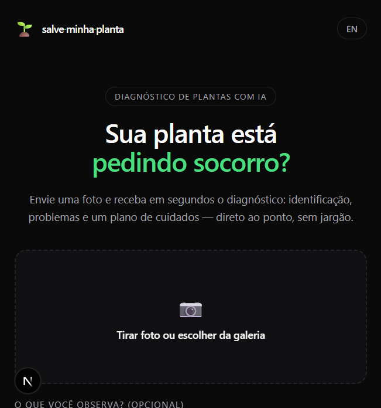
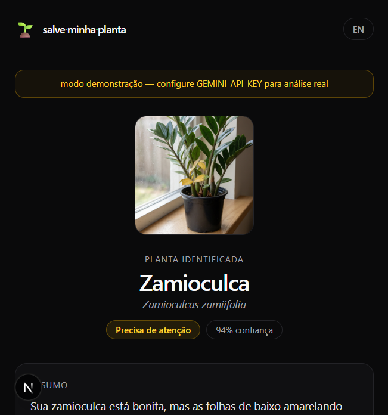
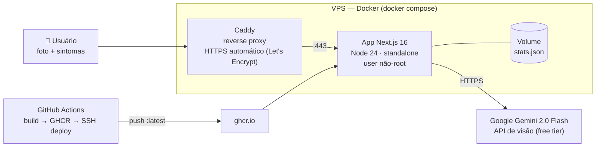

# 🌱 Salve Minha Planta

> Envie a foto da sua planta e receba em segundos o diagnóstico com IA: identificação da espécie, problemas detectados e um plano de cuidados — em português simples, sem jargão.

<p align="center">
  
  
</p>

**🔗 Demo ao vivo:** `https://SEU-DOMINIO` *(atualizar após o deploy)*

## O que ele faz

1. **Foto** — o usuário tira uma foto ou arrasta uma imagem da planta (comprimida no próprio navegador antes do envio).
2. **Diagnóstico** — o modelo multimodal **Gemini 2.0 Flash** identifica a espécie e analisa folhas, coloração e sinais de pragas/doenças, levando em conta os sintomas que o dono descreveu.
3. **Plano de cuidados** — resposta estruturada: problemas encontrados com severidade, causa e solução, mais um plano de rega, luz, solo e uma dica — em PT-BR ou EN.

Recursos de produto:

- 🌎 **Bilíngue** — PT-BR e EN, com preferência salva no navegador
- 🔒 **Privacidade por design** — a foto é processada em memória e nunca armazenada; só contadores anônimos são persistidos
- 📊 **Estatísticas públicas** — contador de plantas analisadas e problemas identificados
- 🛡️ **Proteção** — rate limiting por IP (12 análises/hora), validação de tipo/tamanho de imagem e redimensionamento client-side

## Arquitetura



- **CI/CD**: todo push na `main` builda a imagem (com cache), publica no GitHub Container Registry e faz deploy na VPS via SSH — com healthcheck automático ao final
- **Caddy** emite e renova o certificado TLS sozinho, sem configuração manual
- **Container não-root** com healthcheck e restart policy

## Stack

| Camada | Tecnologia |
|---|---|
| Frontend + API | Next.js 16 (App Router) + TypeScript |
| Estilo | Tailwind CSS 4 (tema escuro, acento verde) |
| IA | Gemini 2.0 Flash (visão) com resposta em JSON estruturado |
| Runtime | Node 24, Docker (multi-stage, ~150 MB) |
| Proxy/HTTPS | Caddy 2 |
| CI/CD | GitHub Actions → GHCR → SSH |
| Custo total | **R$ 0** (free tier do Gemini) + a VPS |

## Rodando localmente

```bash
npm install
npm run dev
```

Sem `GEMINI_API_KEY` o app roda em **modo demonstração** (resposta de exemplo). Para análise real:

```bash
cp .env.example .env   # cole sua chave do aistudio.google.com
npm run dev
```

## Deploy na VPS

Guia completo, passo a passo (para iniciante): [`docs/DEPLOY.md`](docs/DEPLOY.md).

Resumo: configurar DNS → instalar Docker → criar `.env` → `docker compose -f docker-compose.prod.yml up -d`. A partir daí, cada `git push` faz deploy automático.

## Monitoramento

- `GET /api/health` — healthcheck do app (usado pelo Docker e pelo CI)
- `docker compose ps` / `docker logs` na VPS

---

Feito por [João Paulo](https://www.linkedin.com/) · [polaryeti.com](https://www.polaryeti.com) · As fotos nunca são armazenadas.
