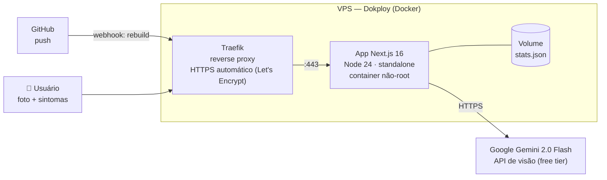

# 🌱 Salve Minha Planta

> Envie a foto da sua planta e receba em segundos o diagnóstico com IA: identificação da espécie, problemas detectados e um plano de cuidados — em português simples, sem jargão.

<p align="center">
  
  
</p>

**🔗 Demo ao vivo:** `https://SEU-DOMINIO` *(atualizar após o deploy)*

## O que ele faz

1. **Foto** — o usuário tira uma foto ou arrasta uma imagem da planta (comprimida no próprio navegador antes do envio).
2. **Diagnóstico** — o modelo multimodal **Gemini 2.0 Flash** identifica a espécie e analisa folhas, coloração e sinais de pragas/doenças, levando em conta os sintomas que o dono descreveu.
3. **Plano de cuidados** — resposta estruturada: problemas encontrados com severidade, causa e solução, mais um plano de rega, luz, solo e uma dica — em PT-BR ou EN.

Recursos de produto:

- 🌎 **Bilíngue** — PT-BR e EN, com preferência salva no navegador
- 🔒 **Privacidade por design** — a foto é processada em memória e nunca armazenada; só contadores anônimos são persistidos
- 📊 **Estatísticas públicas** — contador de plantas analisadas e problemas identificados
- 🛡️ **Proteção** — rate limiting por IP (12 análises/hora), validação de tipo/tamanho de imagem e redimensionamento client-side

## Arquitetura



- **Deploy contínuo**: cada `git push` dispara o rebuild no Dokploy (build da imagem Docker e publicação automáticos)
- **Traefik** (via Dokploy) emite e renova o certificado TLS sozinho, sem configuração manual
- **Container não-root** com healthcheck (`/api/health`) e restart automático

## Stack

| Camada | Tecnologia |
|---|---|
| Frontend + API | Next.js 16 (App Router) + TypeScript |
| Estilo | Tailwind CSS 4 (tema escuro, acento verde) |
| IA | Gemini 2.0 Flash (visão) com resposta em JSON estruturado |
| Runtime | Node 24, Docker (multi-stage) |
| Deploy | Dokploy (build Docker + Traefik + HTTPS) |
| Custo total | **R$ 0** (free tier do Gemini) + a VPS |

## Rodando localmente

```bash
npm install
npm run dev
```

Sem `GEMINI_API_KEY` o app roda em **modo demonstração** (resposta de exemplo). Para análise real:

```bash
cp .env.example .env   # cole sua chave do aistudio.google.com
npm run dev
```

## Deploy

Guia completo, passo a passo (para iniciante): [`docs/DEPLOY.md`](docs/DEPLOY.md).

Resumo: push no GitHub → projeto no Dokploy apontando pro repo → domínio com HTTPS automático. A partir daí, cada `git push` vira deploy sozinho.

## Monitoramento

- `GET /api/health` — healthcheck do app (usado pelo Dokploy)
- Logs e status em tempo real no painel do Dokploy

---

Feito por João Paulo · [polaryeti.com](https://www.polaryeti.com) · As fotos nunca são armazenadas.
